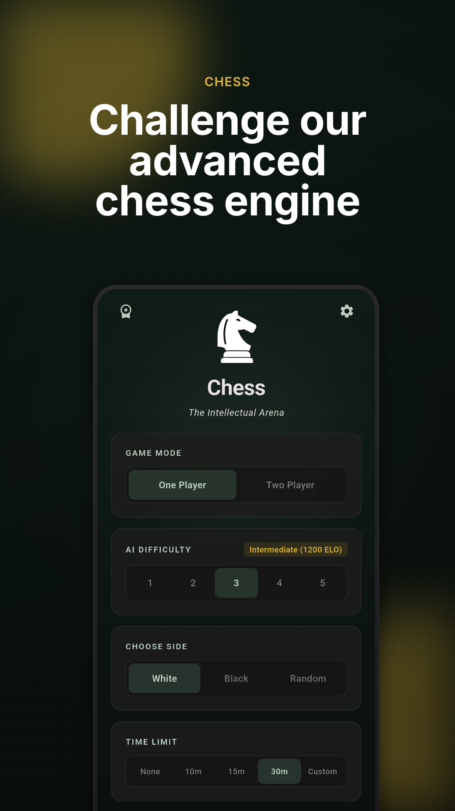
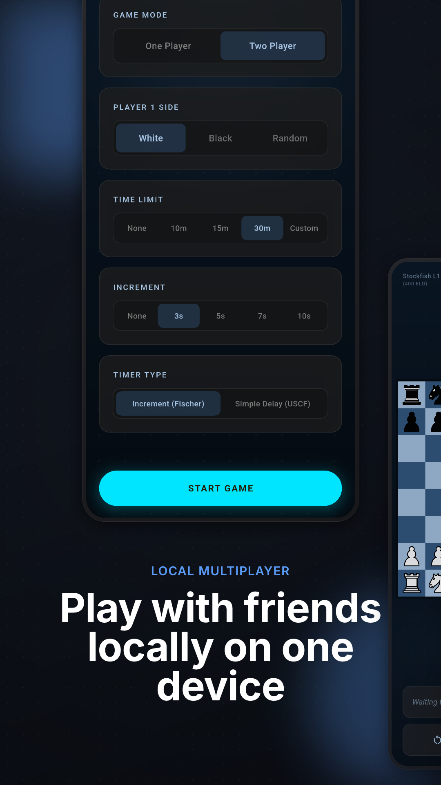
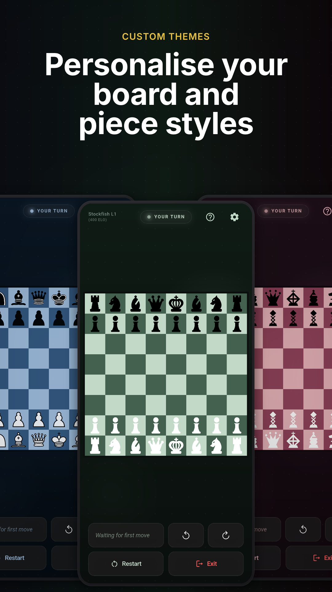
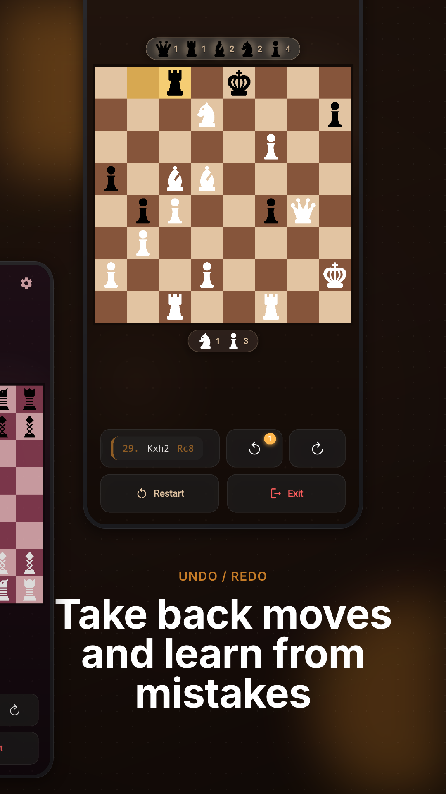
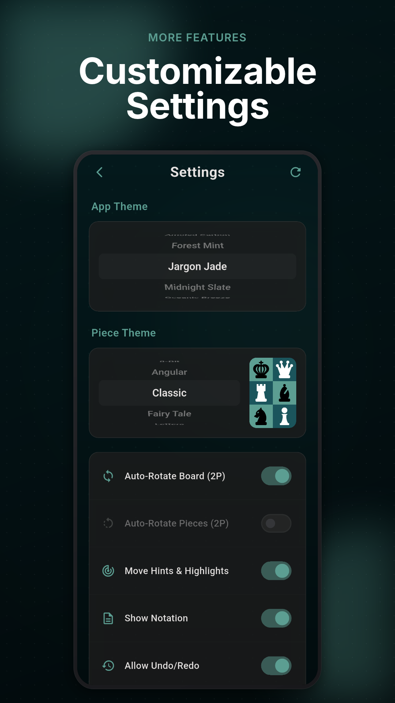

<a href='https://play.google.com/store/apps/details?id=com.shenmareparas.chess'></a>

# ♟️ Chess Offline: Play 2 Player - Flutter Chess Game

A feature-rich chess application built with **Flutter** and the **Flame** engine. It supports single-player games against the world-class **Stockfish Chess Engine** with multiple difficulty levels, offline two-player play, timed games, customizable boards, multiple piece styles, sound effects, haptic feedback, and local preference persistence with game-state save/resume.

[](https://flutter.dev)
[](https://dart.dev)
[](LICENSE)

<a href='https://play.google.com/store/apps/details?id=com.shenmareparas.chess'></a>

## ✨ Features

### 🎮 Game Modes

-   **Single Player**: Play against an intelligent AI opponent with 5 difficulty levels
-   **Two Player Mode**: Offline multiplayer on the same device, with per-player side selection
-   **Side Selection**: Choose to play as white, black, or random
-   **Timed Games**: Optional time controls for competitive play, supporting Fischer Increment and USCF Simple Delay modes
-   **Game Save & Resume**: Exit mid-game and resume from the exact same position later

### 🎨 Customization

-   **8 Beautiful Themes**: Amoled Carbon, Forest Mint, Jargon Jade, Midnight Slate, Oceanic Breeze, Royal Velvet, Warm Walnut, and Winter Glacier
-   **6 Piece Themes**: Classic, Angular, 8-Bit, Letters, Old School, and Fairy Tale
-   **Dark Mode Support**: Multiple dark theme options including pure AMOLED black
-   **Dynamic Mid-Game Theme Propagation**: Switching board or piece themes mid-match immediately re-renders all match UI elements (top bar, status badge, timers, dead pieces counters) and swaps Flame piece textures on-the-fly without resetting match state
-   **Custom Font**: Inter font for clean, readable UI typography
-   **Settings Reset**: One-tap reset to factory defaults via a confirmation dialog
-   **⚡ Performance Optimizations**:
    -   **Stockfish Native Stability & Memory Cap**: Powered by `multistockfish` (by Lichess) running Stockfish 19 with embedded ~1MB NNUE. Configures `Threads` = 1 to prevent lock contention ANRs, caps transposition memory to 16MB (`Hash` = 16) to avoid native/Java heap `OutOfMemoryError` failures on lower-end devices, and enforces single-instance flavor locking to prevent lifecycle conflicts. Additionally filters standard output logging to only dispatch key UCI transitions over the Flutter method channel under `kDebugMode`, reducing channel congestion. All stdin logging in `getBestMove()` is also gated behind `if (kDebugMode)` to ensure zero overhead in release builds.
    -   **Immediate AI Move Search Cancellation**: Halts background Stockfish computations instantly via `StockfishService.instance.stop()` (dispatching UCI `stop` via stdin) and cancels the `CancelableOperation` during move undos, match restarts, and exits, releasing CPU resources and eliminating desynchronized move delivery.
    -   **iOS Mach-O Static Linker Symbol Retention**: Specifies `OTHER_LDFLAGS = $(inherited) -Wl,-u,_stockfish_light_init` and uses an address link hook in `AppDelegate.swift` to ensure `ld` extracts and retains pure C++ engine symbols from `libmultistockfish_light.a` when building with CocoaPods static libraries without `use_frameworks!`.
    -   **Synchronous Bitboard Evaluation via dartchess**: Computes checkmate, stalemate, and FIDE-compliant draw detection (threefold repetition, 50-move rule, insufficient material) via high-speed compiled 64-bit bitboards in `ChessNotationService` (< 0.1ms on the main thread), eliminating background isolate serialization latency, race conditions, and thread overhead.
    -   **Zero-Allocation Castling Checks**: Utilizes direct target attack scans (`_pieceAttacksTile`) inside checkmate and castling legality validations to eliminate temporary list allocations per piece on every move. `_piecesOfTypeForPlayer()` returns a lazy `Iterable.where()` rather than eagerly allocating a `List<ChessPiece>` for ambiguity checks.
    -   **Non-Blocking Startup Layout**: Spawns `runApp()` immediately to render the home screen logo on the first frame. Active piece theme images and audios decode asynchronously in the background rather than freezing the main isolate synchronously before startup.
    -   **Scroll-Debounced Pickers**: App theme and piece theme wheels are debounced (150ms) to avoid heavy layout and theme rebuilds during scroll.
    -   **Lightweight Previews**: Piece preview uses a cached Flutter `StatelessWidget` asset renderer rather than re-instantiating heavy Flame `Game` states.
    -   **On-Demand Piece Theme Loading**: Non-active piece themes load lazily on-demand when selected or previewed, preventing excessive memory usage and GC pauses (`dart::MarkingVisitor`).
    -   **Isolated Background Repaints**: Heavy background paint layers (dot grids in `MainMenuView` and `SettingsView`, and radial blurs) are wrapped in `RepaintBoundary` objects and isolated via `Selector` to prevent unnecessary redraws.
    -   **Responsive Foldable & Dynamic Orientation Support**: `ChessBoardWidget` uses dynamic parent constraints (`LayoutBuilder` `min(maxWidth - horizontalReserve, maxHeight - verticalReserve)`) to automatically scale the board for any aspect ratio without `RenderFlex` overflows, stretching edge-to-edge horizontally on mobile devices. Supports a dedicated Fullscreen mode on foldable devices and wide displays (`shortestSide >= 600` or display features with fold/hinge) via an interactive top bar toggle. In fullscreen, the top bar collapses and the board expands all the way up to the top of the screen (`SafeArea(top: false)`), hiding exit/restart controls and status badges during match play while floating controls on the right side provide exit fullscreen, a dead pieces side-toggle (moving captured pieces to left/right flanks to eliminate 84px of vertical reserve and maximize board size), and a left/right flip toggle. Automatically exits when folded back to a normal phone form factor. The app dynamically manages orientation settings: standard phones and folded outer displays (`shortestSide < 600`) lock to portrait mode, while unfolded inner displays (`shortestSide >= 600`) allow multi-orientation rotation. Main menu options and settings lists are constrained to a max-width of 600px for clean display on large inner screens. The Piece Guide also features an adaptive dual-pane layout on unfolded foldable devices and wide screens, positioning controls and hero previews on the left screen and comprehensive strategy panels on the right screen with dynamic physical hinge and crease avoidance.
    -   **Deferred Flame Init**: Board and sprite initialization is deferred to a `addPostFrameCallback` so it doesn't block the page transition animation.
    -   **Lazy & Guarded Move List**: `MoveList` renders turns lazily via `ListView.builder` and tracks `_lastMoveCount` and `_lastHistoryIndex` so `addPostFrameCallback` only runs when the list or history selection actually changes — not on every timer tick or AI notification.
    -   **Column Layout for Controls Panel**: `GameInfoAndControls` uses a `Column` instead of `ListView(shrinkWrap: true)`, eliminating the double layout pass that occurred on every AppModel notification.
    -   **Selective Provider Subscriptions**: `MainMenuView`, `SettingsView`, and all option pickers use narrow `Selector` and `context.select` subscriptions (instead of blanket `Consumer<AppModel>`), keeping static background layers (`RepaintBoundary`-isolated dot grid & radial glows) and unrelated controls unpainted during state changes.
    -   **Cached Confetti Colors**: Theme-derived confetti colors (computed via `HSVColor` transforms) are cached by theme name in `_ChessViewState` and only recomputed when the active theme actually changes.
    -   **Static AI Random Instance**: `GameController` holds a `static final _random = math.Random()` shared across all AI moves, avoiding 3 PRNG re-seedings per move at difficulty levels 1 & 2.
    -   **Cancellable Notation Fade Timer**: `_NotationOverlay.didUpdateWidget` uses a tracked `Timer? _fadeTimer` (cancelled in `dispose()` and before each new schedule in `didUpdateWidget`) instead of a bare `Future.delayed`, preventing stacked setState callbacks from rapid board rotations within the 600 ms window.
    -   **Lifecycle-Guarded Exit & Save Synchronization**: Cancels in-flight 400ms debounced save timers (`_saveDebounceTimer`) upon match exit or checkmate, guards against auto-saving during OS lifecycle transitions (`isExiting` flag prevents exit interstitial ads from triggering saves), and ignores completed games in storage to ensure a clean home screen state.
    -   **Root Scaffold Rebuild Isolation**: Replaces blanket `Consumer<AppModel>` widgets in `ChessView` with a narrow `Selector` on `gameController`, completely isolating the top-level layout tree (`SafeArea`, `Column`, `TopBar`, board container, controls) from 100ms clock updates, turn changes, or move events.
    -   **Pure Build Function & Reactive Side-Effects**: Pawn promotion dialog prompts and win confetti animation triggers are handled outside the build lifecycle via dedicated `State` listeners and post-frame queues rather than mutating ViewModel flags during widget building.
    -   **Backdrop Blur Compositing Isolation**: `TimerWidget`'s iOS `BackdropFilter` is wrapped in a dedicated `RepaintBoundary` to prevent redundant compositing buffer read-backs during 10 Hz clock updates.
    -   **Parallel SharedPreferences Reset**: Uses `Future.wait([...])` to write factory-reset preferences in parallel rather than issuing 14 sequential method channel requests.
    -   **AdMob Impression Ratio & TTL Optimization**: Replaced eager ad preloading on launch with an on-demand strategy (exit interstitials preload on the 1st match move; rewarded ads preload when available undos reach 0) and enforced a 50-minute TTL to purge expired AdMob tokens and maximize impression-to-request health.
    -   **Reactive Clock & Turn Synchronization**: Scoped timer state bindings with `Selector<AppModel, (AppTheme, Player)>` watching both theme and turn, ensuring active clock border highlights and background tints transition instantaneously without broad container repaints.
    -   **Decoupled MVVM Command & State Encapsulation**: Encapsulated undo, redo, pawn promotion, move-history stepping, and service orchestration (ads, notification permissions, in-app purchases, rating prompts) directly within `AppModel` with zero `BuildContext` coupling. UI views remain pure declarative layouts and dispatchers without inline domain calculations, controller reaching, or direct service calls.
    -   **Reactive Saved-Game State**: Transitioned saved game indicators from manual `setState` queries to a reactive `AppModel.hasSavedGame` listener synchronized with lifecycle events (`newGame`, `exitChessView`, `saveAndExitChessView`, `restoreGameState`).

### 🎯 Gameplay Features

-   **Interactive Piece Guide**: Learn how every chess piece moves, captures, and promotes with an interactive guide accessible directly from the main menu and during matches. Features stutter-free pre-cached piece previews matching the active piece theme, live color toggle (White/Black), authentic piece classifications (Pawn, Minor Piece, Major Piece, The Monarch), glowing material value badges, quick-spec attribute chips, and a unified single-card description panel with clean horizontal dividers separating movement mechanics, grandmaster strategy tips, and special rules with natural start-aligned typography. On foldable and wide screens, automatically adapts to a dual-pane layout placing controls and piece previews on the left pane and comprehensive strategy guides on the right pane with dynamic hinge avoidance and tabletop flex-mode support.
-   **Move History Preview**: Move lists are fully clickable. Tap any past move to review the board state at that position (which pauses active AI, but keeps timers running and disables board taps). In offline 2-Player mode, board auto-rotation and piece auto-rotation are paused during history review so the player reviewing past positions isn't disoriented by sudden flips. Navigate through moves using the bottom-right chevron buttons, copy all history via a long-press, or tap the prominent **RESUME** button in the top status bar to return to the live game state without any layout shifts. The active tile dynamically calculates its width from character measurements to ensure it always auto-scrolls perfectly to the center of the viewport.
-   **Undo/Redo with Ad Bank & Smart Step**: Start each game with 1 free undo; earn an extra undo by watching a rewarded ad. In 1-player mode against Stockfish, smart undo detects the last player to move: if the human was the last mover (including after delivering checkmate or stalemate), a single undo is executed, restoring the match and restarting countdown timers if timed. If the AI was the last mover, a standard two-move undo is performed. Active AI computations are halted immediately via `stop` on undo.
-   **Remove Ads & Unlimited Undos (In-App Purchase)**: Optional one-time product (`remove_ads`) permanently removes all exit interstitials and rewarded ads, unlocking infinite undos with an `∞` badge indicator and seamless store purchase restoration. Accessible via a top-left quick-action button on the main menu, with resilient error/cancellation handling and circular progress indicators.
-   **Exit Match Interstitial Ads**: Displays a non-intrusive interstitial ad when leaving a chess match back to the main menu (with AdMob Console server-side frequency capping and instant offline fallback)
-   **In-App Store Rating Prompt**: Seamlessly prompts for app rating/review on Google Play Store or App Store using `in_app_review` after a human victory upon returning to the main menu (guarded by `hasRatedApp` user preference)
-   **Accessible Tooltips**: Action buttons across Main Menu, Game View, and Settings (Settings, Back, Reset, Close, Piece Guide) feature accessible tooltips.
-   **Move Hints & Highlights**: Visual indicators and highlights for valid moves and selected tiles
-   **Edge-to-Edge Flat Board Layout**: Stretches right to the borders of the screen with zero side margins and flat, border-aligned sharp corners (no outer borders, rounded corners, or shadows)
-   **Foldable Fullscreen Mode**: Dedicated one-tap fullscreen mode on foldable devices and wide displays that expands the chessboard all the way up to the top of the display (`SafeArea(top: false)`), hiding the top bar, turn status pill, and restart/exit controls to maximize board size across square-ish inner displays. A floating action column on the right side provides instant exit fullscreen, a dead-pieces side layout toggle (relocating captured pieces to the left and right flanks to remove 84px of vertical reserve), and a left/right side flip toggle. Automatically exits when folding to outer cover screens.
-   **Captured Pieces Display**: Shows dead pieces count-grouped (e.g. Pawn 4, Knight 2) inside theme-tinted frosted glass pills. Supports standard horizontal rows (top and bottom of the board) as well as vertical flank capsules (left and right sides of the board in fullscreen mode). Features an ambient silhouette glow for black pieces on dark backgrounds, automatically counts captured promoted pieces under their promoted type, and dynamically flips alignment on board rotation. Can be toggled on/off in Settings (default: on).
-   **Alternating Board Notation**: Algebraic coordinates on the board borders dynamically use the alternating background tile color (e.g. dark text on light tiles, light text on dark tiles) for crisp legibility.
-   **Sound Effects**: Audio feedback for piece movements using a pooled `AudioPool` for rapid playback
-   **Haptic Feedback**: Configurable vibration patterns — light for moves, medium for captures/checks, heavy for stalemates, vibrate for checkmates (default: on)
-   **Daily Practice Notifications**: Adaptively schedules daily reminder notifications at the player's most frequent playing hour, with built-in permission handling and blocked-notification recovery (default: on)
-   **Auto-Rotate Board**: Automatic board rotation based on turn in offline 2-Player mode (configurable)
-   **Auto-Rotate Pieces**: Rotates Player 2's pieces 180 degrees (pi) in offline 2-Player mode if board auto-rotation is disabled (configurable)
-   **Rotation Animation**: Smoothly animates board and piece rotation transitions; can be disabled in Settings for instant snapping (default: on)
-   **Context-aware Game Status**: The status indicator uses custom background, border, text, and dot colors that adapt dynamically to the active state or outcome of the game (e.g., success green for wins, red for losses, gray for stalemates and FIDE draws)
-   **Smooth Animated Promotion Handling**: Glassmorphic pawn promotion picker with custom spring scale and fade transition (`Curves.easeOutBack` over 240ms) via `showGeneralDialog` (wrapped in `PopScope(canPop: false)` to require an explicit piece choice).
-   **Check Detection & Dynamic Undo Sync**: Visual red check mark highlight on the king piece for checks and checkmate. Dynamically synchronizes across both forward moves and move undos (in single-player AI games and two-player offline matches), as well as during move history navigation without stale indicators.
-   **FIDE Draw Detection & Granular Status**: Full support for FIDE draw rules including threefold repetition (via Polyglot 64-bit Zobrist hashes across the game tree), 50-move rule, and insufficient material with clear status indicators in the game pill (e.g. Draw (Repetition), Draw (50-Move Rule), Draw (Material))
-   **PGN & FEN Export**: Standard tournament PGN export with tournament headers, SAN move notation, and game results, plus live FEN serialization. Long-press on the move list copies full PGN to clipboard with a glassmorphic confirmation toast
-   **Stalemate Detection**: Proper game-end condition handling
-   **GDPR & Privacy Consent Management (UMP)**: Fully integrates Google's certified User Messaging Platform (UMP) SDK for IAB TCF v2.2 compliance in the EEA, UK, and Switzerland, providing an on-demand "Ad Privacy Settings" tile in Settings to reconfigure consent choices at any time.

### 🤖 AI Features

-   **World-Class Engine**: Powered by the highly optimized **Stockfish 19** engine via `multistockfish` (by Lichess).
-   **Native Stability & Resource Caps**: Leverages `StockfishFlavor.light` with an embedded ~1MB NNUE network, configured with `Hash` = 16 and `Threads` = 1 to prevent native OutOfMemoryErrors and thread lock contention ANRs.
-   **Castling UCI Translation**: Features automated castling move translation mapping custom king-captures-rook engine moves to standard UCI notation (e.g. `e1g1`, `e1c1`), preventing AI logic desyncs and crash states.
-   **5 Difficulty Levels**: Smooth progression from Beginner (400 ELO), Casual (800 ELO), Intermediate (1200 ELO), Advanced (1600 ELO), to Master (2000 ELO). Levels 1 & 2 run Stockfish at Skill 0 with a randomized blunder pass (60% and 25% chance of random legal moves respectively) to ensure beginner-friendly play, while levels 3–5 natively leverage `UCI_LimitStrength` and `UCI_Elo` engine options.
-   **Real-time Move Logs**: Asynchronous stdin/stdout UCI command processing with filtered logging under `kDebugMode`.
-   **Safe Cancellation**: Search calculations are run asynchronously and cleanly halted on game restart, undo, or exit via engine UCI `stop` and `CancelableOperation` cancellation.

### 🏆 Achievements

-   **Google Play Games Services** (Android) integration via `games_services` (disabled/hidden on iOS)
-   8 achievements: First Game, First Win, Beat Level 5, Timed Win, Pawn Promotion, Put in Check, Play 10 Games (incremental), Play 50 Games (incremental)
-   Silent sign-in on startup (run as an async microtask); interactive sign-in and native achievements UI on demand (Android only)


## 📸 Screenshots

<p align="center">
  
  
  
  
  
</p>

## 🛠️ Technologies Used

-   **[Flutter](https://flutter.dev/)** — UI framework (Dart ≥ 3.0.0, app version `1.0.7+15`)
-   **[cupertino_ui](https://pub.dev/packages/cupertino_ui)** & **[material_ui](https://pub.dev/packages/material_ui)** — UI design components and styling wrappers
-   **[Flame](https://flame-engine.org/)** — 2D game engine for chess board rendering
-   **[Provider](https://pub.dev/packages/provider)** — State management
-   **[Shared Preferences](https://pub.dev/packages/shared_preferences)** — Local data persistence (settings & full game-state save/restore)
-   **[multistockfish](https://pub.dev/packages/multistockfish)** — Native Stockfish 19 chess engine wrapper by Lichess with embedded ~1MB NNUE and UCI communication
-   **[dartchess](https://pub.dev/packages/dartchess)** — Fast, immutable chess rules, bitboard legal move validation, SAN formatting, PGN generation, FEN serialization, and FIDE-compliant draw evaluation by Lichess
-   **[sound_effect](https://pub.dev/packages/sound_effect)** — Ultra-low latency native audio playback by Lichess for instantaneous move sounds
-   **[Google Mobile Ads](https://pub.dev/packages/google_mobile_ads)** — Rewarded interstitial ads ("1 Ad = 1 Undo" mechanic) and exit interstitial ads (`google_mobile_ads` 9.1.0 with native `Google-Mobile-Ads-SDK` 13.9.0)
-   **[Games Services](https://pub.dev/packages/games_services)** — Google Play Games (Android) achievements
-   **[Confetti](https://pub.dev/packages/confetti)** — Celebration effects on win
-   **[Fluttertoast](https://pub.dev/packages/fluttertoast)** — Native platform toast notifications (developer Easter egg countdown)
-   **[flutter_local_notifications](https://pub.dev/packages/flutter_local_notifications)** — Local scheduled reminders for daily practice
-   **[in_app_purchase](https://pub.dev/packages/in_app_purchase)** — In-app purchases / monetization
-   **[async](https://pub.dev/packages/async)** — `CancelableOperation` for cancellable AI compute tasks
-   **[in_app_update_flutter](https://pub.dev/packages/in_app_update_flutter)** — Cross-platform native in-app updates for Android (Google Play flexible background updates) and iOS (StoreKit)
-   **[in_app_review](https://pub.dev/packages/in_app_review)** — Google Play Store & App Store native rating prompt

## 📦 Installation

### Prerequisites

-   Flutter SDK (3.0.0 or higher)
-   Dart SDK (3.0.0 or higher)
-   Android Studio / Xcode (Android Gradle Plugin 9.5.1, Gradle 9.7.1, Kotlin 2.4.20, iOS 15.0+ deployment target)
-   A device or emulator

### Steps

1. **Clone the repository**

    ```bash
    git clone https://github.com/shenmareparas/Chess.git
    cd Chess
    ```

2. **Install dependencies**

    ```bash
    flutter pub get
    ```

3. **Run the app**

    ```bash
    flutter run
    ```

4. **Build for production** (optional)

    ```bash
    # Android
    flutter build apk --release

    # iOS
    flutter build ios --release
    ```

### 🎨 Marketing & Screenshots Editor

To design, preview, and bulk-export Google Play Store screenshots:

1. **Navigate to the editor directory**
    ```bash
    cd screenshots_editor
    ```
2. **Install dependencies**
    ```bash
    bun install   # or npm install / pnpm install / yarn install
    ```
3. **Start the local server**
    ```bash
    bun dev       # or npm run dev / pnpm dev / yarn dev
    ```
4. **Open in browser**
    Visit [http://localhost:3000](http://localhost:3000) to edit layouts, snap-center elements, toggle bezel notches, adjust background film noise, and export high-resolution assets.


## 📁 Project Structure

```
lib/
├── main.dart                       # App entry point; preloads assets, initializes AdMob, notifications & Play Games
├── model/
│   ├── app_model.dart             # Central state/ViewModel; delegates to services/prefs
│   ├── game_state.dart            # Pure Model holding active game outcome/ply state
│   ├── app_themes.dart            # 8 board/UI theme definitions (sorted alphabetically)
│   ├── user_preferences.dart      # SharedPreferences wrapper; defines PIECE_THEMES constant
│   └── player.dart                # Player enum (player1, player2, random)
├── logic/
│   ├── chess_board.dart           # Pure chess rules engine: board state, push/pop moves, check detection
│   ├── chess_game.dart            # Flame rendering layer: board drawing, sprites, tap routing
│   ├── game_controller.dart       # Logic ViewModel: move orchestration, AI, undo/redo, promotion, haptics
│   ├── chess_piece.dart           # ChessPiece model and ChessPieceType enum
│   ├── chess_piece_sprite.dart    # Flame Sprite component for chess pieces
│   ├── chess_constants.dart       # Shared constants (e.g. PROMOTIONS list)
│   ├── shared_functions.dart      # Utilities: formatPieceTheme, oppositePlayer, tile↔coordinate helpers
│   ├── stockfish_service.dart     # Native Stockfish 19 engine interface via multistockfish
│   ├── chess_notation_service.dart # PGN/SAN formatting, FEN export, and FIDE draw evaluation (dartchess)
│   ├── in_app_purchase_service.dart # In-app purchases / remove ads (in_app_purchase)
│   ├── game_state_storage.dart    # Full game-state save/load/clear via SharedPreferences
│   ├── timer_service.dart         # Per-player countdown timers with pause/resume support
│   ├── audio_service.dart         # Pooled piece-move sounds and game-end audio
│   ├── haptic_service.dart        # Centralized haptic feedback (selection/light/medium/heavy/vibrate)
│   ├── notification_service.dart  # Daily practice notification scheduling & permission handling
│   ├── ad_service.dart            # RewardedInterstitialAd singleton ("1 Ad = 1 Undo") & UMP consent
│   ├── play_games_service.dart    # GPGS/Game Center achievements singleton
│   ├── in_app_update_service.dart # In-app updates via Google Play (Android flexible) & StoreKit (iOS)
│   ├── rating_service.dart        # Google Play Store / App Store rating prompt (in_app_review)
│   └── move_calculation/
│       └── move_classes/
│           ├── move.dart              # Move (from, to, promotionType)
│           ├── move_meta.dart         # Move metadata (isCheck, isCheckmate, isStalemate, promotion)
│           ├── move_stack_object.dart # Board move-stack entry (push/pop undo/redo)
│           └── direction.dart         # Direction enum for sliding piece calculations
└── views/
    ├── main_menu_view.dart        # Main menu: game mode, difficulty, time, side selection
    ├── chess_view.dart            # Game screen: board, timers, controls, confetti, exit dialog
    ├── piece_guide_view.dart      # Interactive piece movement & strategy guide
    ├── settings_view.dart         # Settings: theme pickers, toggles, achievements tile, reset
    └── components/
        ├── chess_view/
        │   ├── chess_board_widget.dart         # Flutter↔Flame GameWidget bridge with top/bottom/side captured pieces slots
        │   ├── captured_pieces_row.dart        # Frosted glass dead pieces display (horizontal row & vertical flank modes)
        │   ├── promotion_dialog.dart           # Animated glassmorphic promotion picker
        │   ├── promotion_option.dart           # Individual promotion piece option
        │   ├── piece_guide/
        │   │   ├── piece_descriptions.dart     # Comprehensive piece movement, abilities & tips data
        │   │   └── piece_selector_item.dart    # Horizontal piece carousel item with theme integration
        │   ├── game_info_and_controls.dart     # Bottom panel layout
        │   └── game_info_and_controls/
        │       ├── game_status.dart            # Turn/result status text
        │       ├── timer_widget.dart           # Animated countdown timer display
        │       ├── timers.dart                 # Dual-timer row
        │       ├── moves_undo_redo_row.dart    # Undo/redo controls row (main row layout)
        │       ├── restart_exit_buttons.dart   # Restart and exit action buttons
        │       └── moves_undo_redo_row/
        │           ├── move_list.dart          # Interactive move list panel
        │           ├── rounded_icon_button.dart# Reusable icon button
        │           └── undo_redo_buttons.dart  # Smart undo/redo control buttons
        ├── main_menu_view/
        │   ├── main_menu_buttons.dart          # Start / Resume game buttons
        │   ├── remove_ads_button.dart          # Floating remove ads & unlimited undos button
        │   ├── game_options.dart               # Options panel container
        │   └── game_options/
        │       ├── game_mode_picker.dart       # 1P / 2P mode selection
        │       ├── ai_difficulty_picker.dart   # Difficulty 1-5 selection
        │       ├── time_limit_picker.dart      # Time control selection
        │       ├── timer_increment_picker.dart # Time increment value selection
        │       ├── timer_mode_picker.dart      # Time control mode (Fischer increment vs USCF delay)
        │       └── side_picker.dart            # White / Black / Random side picker
        ├── settings_view/
        │   ├── app_theme_picker.dart           # Board theme CupertinoPicker (debounced 150ms)
        │   ├── piece_theme_picker.dart         # Piece theme CupertinoPicker + Easter egg
        │   ├── piece_preview.dart              # Lightweight StatelessWidget piece preview
        │   ├── remove_ads_tile.dart            # In-app purchase tile for remove_ads & restore
        │   ├── toggle.dart                     # Reusable switch row
        │   └── toggles.dart                    # All settings toggles, GDPR consent + Achievements
        └── shared/
            ├── glass_panel.dart               # Glassmorphic container with optional animation
            └── bottom_padding.dart            # Safe-area bottom padding
```

## 🧠 AI Engine & Algorithm

The chess application interfaces with the **Stockfish 19 Chess Engine** using the **UCI (Universal Chess Interface)** protocol via Dart FFI with the `multistockfish` package (by Lichess).

### How It Works

1. **UCI Protocol Integration**: The app sends standard chess commands (`position startpos moves ...`, `go depth X movetime Y`) to the engine's standard input and listens to its standard output for search information and the computed `bestmove`.
2. **Readiness Synchronization**: To prevent race conditions, the engine uses event-driven synchronization (`readyok` response completers) before executing position evaluations.
3. **Engine Settings mapping**:
    - **Level 1 (Beginner - 400 ELO)**: Skill Level 0, depth 1, search time limit 100ms. Features a 60% chance of playing a random legal move (blunder pass).
    - **Level 2 (Casual - 800 ELO)**: Skill Level 0, depth 3, search time limit 200ms. Features a 25% chance of playing a random legal move (blunder pass).
    - **Level 3 (Intermediate - 1200 ELO)**: Natively leverages `UCI_LimitStrength` and target `UCI_Elo` of 1200, search time limit 400ms.
    - **Level 4 (Advanced - 1600 ELO)**: Natively leverages `UCI_LimitStrength` and target `UCI_Elo` of 1600, search time limit 800ms.
    - **Level 5 (Master - 2000 ELO)**: Natively leverages `UCI_LimitStrength` and target `UCI_Elo` of 2000, search time limit 1500ms.

**Learn more**: [Stockfish Chess Engine Official Website](https://stockfishchess.org/)

## ⚙️ Configuration

The app stores user preferences locally using SharedPreferences:

-   Selected board theme (`themeName`)
-   Piece theme preference (`pieceTheme`)
-   Move history visibility (`showMoveHistory`)
-   Sound enabled (`soundEnabled`)
-   Hint display settings (`showHints`)
-   Board notation visibility (`showNotation`)
-   Show captured pieces (`showCapturedPieces`, default: `true`)
-   Board rotation preference (`enableRotation`)
-   Piece rotation preference (`enablePieceRotation`)
-   Rotation animation preference (`enableRotationAnimation`, default: `true`)
-   Undo/Redo availability (`allowUndoRedo`)
-   Haptic feedback (`hapticEnabled`, default: `true`)
-   Daily practice notification (`dailyPracticeNotification`, default: `true`)
-   Ad-free status (`isAdFree`, persistent across settings reset)
-   In-app store rating status (`hasRatedApp`)

Defaults are defined in `lib/model/user_preferences.dart`. Game state (board position, move history, timers, undo bank) is persisted separately in `lib/logic/game_state_storage.dart` and restored on app resume.

## 🎯 Usage

1. **Start a New Game**: From the main menu, configure your game settings
2. **Select Mode**: Choose between 1-player (vs AI) or 2-player mode
3. **Choose Difficulty**: For AI games, select from 5 difficulty levels
4. **Choose Side**: Pick White, Black, or Random for either game mode
5. **Set Time**: Optionally enable a time control
6. **Customize**: Pick your preferred theme and piece style in Settings
7. **Play**: Tap pieces to select them, then tap valid squares to move
8. **Save & Resume**: Exit mid-game to save progress and continue later from the main menu

## 🤝 Contributing

Contributions are welcome! Here's how you can help:

1. Fork the repository
2. Create a feature branch (`git checkout -b feature/amazing-feature`)
3. Commit your changes (`git commit -m 'Add some amazing feature'`)
4. Push to the branch (`git push origin feature/amazing-feature`)
5. Open a Pull Request

## 📝 License

This project is licensed under the GNU General Public License v3.0 (GPL-3.0) — see the [LICENSE](LICENSE) file for details.

### Third-Party Licenses

- **Stockfish Chess Engine**: Licensed under the [GNU General Public License v3.0 (GPL-3.0)](https://www.gnu.org/licenses/gpl-3.0.html).
- **multistockfish**: Native multi-platform Stockfish wrapper by [lichess.org](https://lichess.org), licensed under the [GNU General Public License v3.0 (GPL-3.0)](https://github.com/lichess-org/multistockfish).
- **dartchess**: Fast, immutable chess rules, bitboard calculations, and notation library by [lichess.org](https://lichess.org), licensed under the [GNU General Public License v3.0 (GPL-3.0)](https://github.com/lichess-org/dartchess).

## 👨‍💻 Author

**Paras Shenmare**

-   GitHub: [@shenmareparas](https://github.com/shenmareparas)
-   Google Play: [Download Chess](https://play.google.com/store/apps/details?id=com.shenmareparas.chess)

## 🙏 Acknowledgments

-   Chess piece graphics from various open-source sets
-   Inter font
-   Flutter and Flame communities

## 📞 Support

If you encounter any issues or have suggestions, please [open an issue](https://github.com/shenmareparas/Chess/issues).

---

⭐ If you like this project, please give it a star on GitHub!
